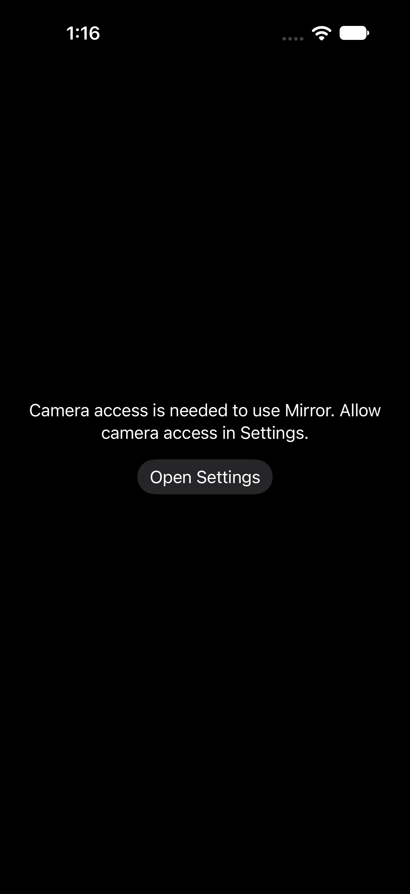
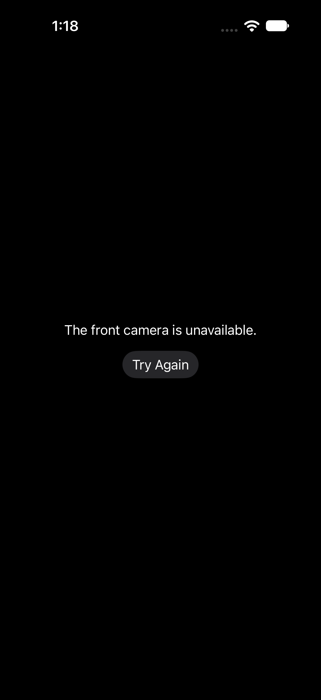

# Mirror release qualification — in progress

App: Just a Mirror!, com.calvincheah.mirror, version 1.0/build 17. Overall production readiness and App Store resubmission are **Pending**. No publication request has been sent to Apple for this candidate.

## Implemented and reviewed

Camera authorization is refreshed on re-entry; denial offers Settings recovery. Active/inactive lifetime controls capture, immediately conceals the preview, restores screen brightness, and rejects stale camera events. Mirroring is configured after a preview connection exists. Failures and interruptions have recovery paths; digital zoom has accessible labels/values. Shipping defaults use real local Apple services, with no accounts, storage, analytics, network services, purchases or third-party SDKs.

Independent medium review cleared shipping commit `e353f43c858b12e0c45f34ead2340f01cfb34c3a`, tree `abc835d1af1f88a03a43bbeac405d5d1141721d1`. Its notification-race P2 and missing-results-receipt P2 were fixed with focused reproductions/regressions. Optimized unit invocations enable testability only for internal test imports; normal shipping Release archives retain their default settings.

## Executed evidence

See [machine-readable evidence](release/evidence.json) for timestamps, actual exits, source hashes, redacted argv, log hashes and private raw artifact locations.

| Check | Result | Environment / limit |
| --- | --- | --- |
| Full camera/brightness unit suite | 14 passed, 0 failed, 0 skipped | Optimized Release/testability, iOS 27.0 simulator build 24A434, Xcode 27.0 build 27A266a |
| Denied-camera UI / re-entry | 1 passed, 0 failed, 0 skipped | Actual OS permission prompt; fresh consent state; screenshot retained |
| Granted / unavailable-camera / retry / re-entry UI | 1 passed, 0 failed, 0 skipped | Actual simulator camera service; screenshot retained; no synthetic preview |
| Python receipt/document regressions | 15 passed | Includes stalled Git metadata and missing result-bundle failure controls |
| Normal signed device Release build | Passed; strict signature verification passed | Apple Development provisioning; bundle 1.0/17, iPhone/portrait/iOS27, privacy manifest included |
| Physical UI attempt | Failed to bootstrap; 0 passed | iPhone 13 Pro, actual iOS 27.2 build 24B5089g; passcode required then testmanagerd connection lost; no camera acceptance established |
| Xcode Cloud build 17 | Succeeded | Exact shipping commit e353f43; stable Xcode27; App Store Connect preparation |
| Uploaded build 17 | Validated; Ready to Submit | iPhone, min iOS27.0, SDK24A430, no non-exempt encryption, get-task-allow false |

Local signed build evidence: `/private/tmp/mirror-release-device-1`. Raw physical diagnostics remain local and are not uploaded as review evidence. The unit receipt predates the later missing-results guard and retained UI screenshots; shipping source and all unit-test file hashes still match the reviewed candidate. Subsequent changes are test evidence/records, not shipping behavior.

## Inspected visuals

These are actual iPhone 18 Pro simulator screenshots, captured by XCTest, retained unchanged and inspected on October 13. The explanations and recovery controls are visible and legible. They establish these fallback states only; they do not satisfy Apple's physical-device recording request.

## Remaining gates and next actions

- Coordinator: unlock/read actual readiness of both the Mac and iPhone, keep them awake, then rerun the physical UI test with a fresh artifact path. Inspect live mirroring, light/zoom, Settings grant/revocation, portrait behavior and app-switcher concealment; verify actual brightness restoration against the device checklist.
- Coordinator: create and inspect a genuine non-private physical-device recording from launch through typical flow. The user authorized this demo to Apple. Preserve exact device OS, source/build and recording provenance. No simulator/mock recording is acceptable. The available phone runs iOS27.2; do not call that public/stable OS coverage.
- Coordinator: verify product-page screenshots against current app behavior, publish the corrected support/privacy documents through reviewed main integration, and activate/qualify prepared required-check protection. PR #2 remains draft; PR #1 remains unmerged.
- Coordinator: send the [prepared App Review response](../APP_REVIEW_RESPONSE.md) with the genuine recording, select the matching validated build17 and verify resubmission in App Store Connect. Current rejected version still selects build1; no Notes/reply/submission changes were sent. Automatic release after Apple approval is already selected.
- Coordinator: retain hosted iOS regression receipts when the new CI step finishes; its build step passed, regression step is still running at this checkpoint. Do not replace actual simulator execution with compile-only coverage.

## Local recovery and preservation

Original Documents-backed Git metadata became iCloud dataless and read operations stalled. Directory and per-reference download requests did not immediately restore it. A fully local clone at `/private/tmp/mirror-release-local` was created from published setup `d9ca65f`, preserving the original checkout/index/app/media. Worker changes were copied from committed, owned files and integrated into the release commit; source-bound raw receipts remain available. The committed candidate is backed up on `codex/app-store-release` and [draft PR #2](https://github.com/calvinc903/mirror/pull/2). Temporary raw artifacts still need durable preservation before cleanup.

Cloud workflow rollback: change Default → Archive iOS → Distribution Preparation from App Store Connect back to TestFlight (Internal Testing Only). This is separate from reverting app source. Do not reuse builds8–16 for App Store submission; they are internal-only. Build17 is the validated eligible candidate.
